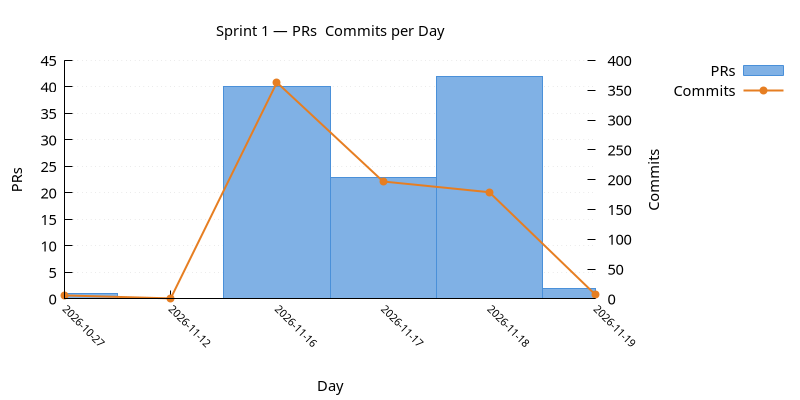
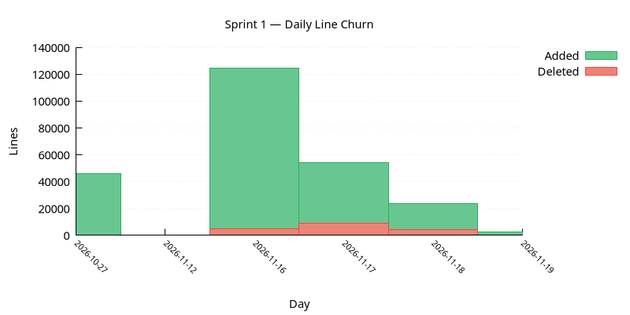
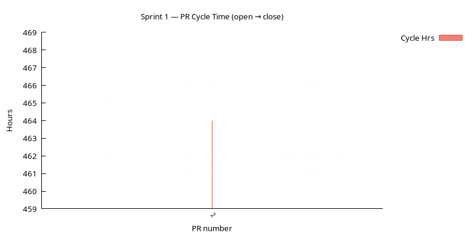
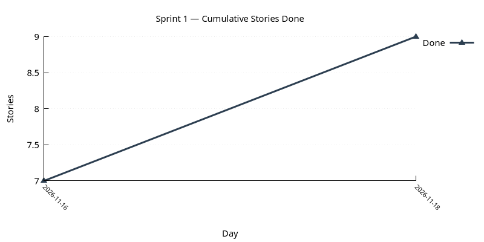

*November 2026*

The first release of compass-ng, the C++ replacement for ORE Studio's Python codegen and gates. It parses every org document of a project into data-oriented tables, keeps what it computes in a content-addressed store that every worktree shares, and runs codegen and checks as codecs that touch only what changed. It regenerates ORE Studio's code byte for byte as `ores.codegen` does, and one `compass check` runs every ORE Studio gate that needs no build, which the ORE Studio fleet now runs before each push and after each edit. Projects can write their own checks as literate org documents, and CI builds, tests and packages compass on Linux, macOS and Windows and reports every test to CDash. Sprint 1 is still open: this release ships what has merged so far, so ORE Studio's CI can install compass from a release rather than build it.

---

# ✅ Highlights

-   **Org documents as data.** Every org file of ORE Studio and of this repository loads into data-oriented tables, typed by a registry built from the document contract.
-   **A store every worktree shares.** A run never parses again a file whose content any worktree has already parsed, and a run with nothing changed finishes in under a second.
-   **Codegen identical to ORE Studio's.** compass regenerates ORE Studio's generated code byte for byte as `ores.codegen` does.
-   **The gates as codecs.** `compass check` runs every ORE Studio gate that needs no build, with ratchet mode, inline exceptions, `--commit` to prove a check on a past commit and `--codec` to run one check alone.
-   **Checks as data.** A project writes a check as an org document under `compass/checks/`: its rule in prose, its definition in property drawers, its examples as its tests. The first, portable C++ facilities, catches the `std::atomic<std::shared_ptr>` that broke ORE Studio's macOS build.
-   **CI on three platforms.** Linux, macOS and Windows builds, tests and packages, with every test reported to CDash and grouped by component.

# 🛠️ Key Improvements

## Parsing & Data Model

-   **Extract the data model**: A knowledge document that states the compass data model as ORE Studio has it, and how compass-ng represents it.
-   **Parse org documents**: Every org file in ORE Studio and in this repository loads into data-oriented tables with full fidelity, typed by a registry built from the document contract.

## Pipeline & Store

-   **Share a content-addressed store**: A run never re-parses a file whose content any worktree of the repository has already parsed, and a run with nothing changed finishes in under a second.
-   **Run codecs and write only changes**: Any output or check is a codec over the in-memory tables; a run touches only outputs whose content changed, and a diff run shows the effect of a change without writing to disk.

## Codegen

-   **Port ORE Studio codegen**: compass regenerates all of ORE Studio's generated code byte-for-byte identical to ores.codegen, in less than 30 seconds for a full run, touching only files whose content changes.

## Gates & Checks

-   **Run the gates as codecs**: One compass check command runs every ORE Studio gate that needs no build in seconds, locally, in CI and after each edit, with ratchet mode, inline exceptions and checks that can be proven on past commits.

## CLI & Tooling

-   **Ship the compass CLI**: The compass executable runs the pipeline on any checkout: it generates codec outputs, prints a diff that writes nothing, reports diagnostics with a check exit status, and collects the store, configured from a file in the repository.

## Build, CI & Release

-   **Report builds and tests to CDash**: Every CI build of compass submits its configure, build, test and coverage results to a CDash project, and a failing build is visible there with its log.

## Agile & Documentation

-   **Project shape**: The repository has the ORE Studio shape — `doc/`, `projects/`, components with parts and facets — and the documents that define it.

# ⚠️ Known Issues & Postponed

Sprint 1 is still open. In progress:

-   **Publish installable binaries**: this release is its first.
-   **Let projects define their own checks**: the `forbid` engine runs check documents; ORE Studio is moving `portable_stop` onto one.
-   **Catch the errors LLMs introduce**: ORE Studio's failed builds are mined and the first of five checks has shipped.
-   **Clear the valgrind findings**: the debug nightly's memcheck still reports findings, most of them not compass's.
-   **Bring up compass legacy** and **Measure the baseline**.

Not started: analyse C++ and SQL, export HTML identical to Emacs, gate the Zettelkasten, retire legacy tooling, design output for LLMs, search the documents, serve search with Typesense and query the documents. Choosing a storage engine was abandoned.

# 📈 Sprint Charts

## PRs and Commits per Day

Dual-axis bar chart. PRs (left axis) and commits (right axis) per day. A high commits-to-PR ratio may indicate scope creep.

## Daily Line Churn

Lines added (green) and deleted (red) per day. Building work produces mostly additions; refactoring produces a mix.

## PR Cycle Time

Hours from PR open to merge, one bar per PR. Long bars indicate review bottlenecks.

## Cumulative Stories Done

Line chart tracking stories marked DONE during the sprint. Steady upward slope is healthy; plateauing signals a stall.

# 📊 Time Summary

-   **Total effort**: not tracked
-   **PRs merged**: 95 (since the first commit, 2026-10-27 to 2026-11-18)
-   **Sprint duration**: 2026-10-27 → 2026-11-18

---

*Next: run `compass check` in ORE Studio's CI from this release and retire the Python gates it replaces, clear the valgrind findings, and ship the next mined checks.*
