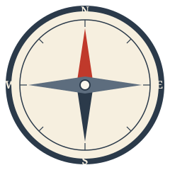
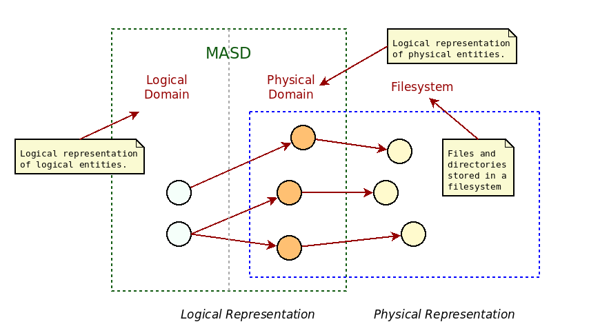
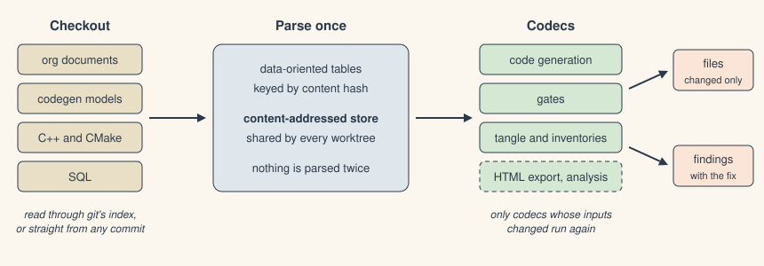

#+title: compass-ng

#+attr_html: :width 180px :alt A compass rose

#+HTML: 

#+html: 
#+html: 
#+html: 
#+html: 
#+html: 
#+html: 
#+html: 
#+html: 
#+html: 
#+html: 
#+html: 
#+html: 
#+html: 
#+html: 
#+html: 
#+html: 
#+html: 
#+html: 
#+html: 
#+html: 
#+html: 
#+html: 
#+html: 
#+html: 
#+HTML: 

compass-ng keeps a model-driven code base consistent with its own models,
documents and rules, fast enough to run on every edit. It reads a project's
org documents, models, C++ and SQL into memory once, then runs /codecs/ over
them. Codecs generate code, check rules and report what to fix. Its first
client is [[https://github.com/OreStudio/OreStudio][ORE Studio]], a large C++ code base developed mostly by LLM agents.

* Model Assisted Software Development

compass comes from the [[https://github.com/MASD-Project][MASD Project]]. MASD, /Model Assisted Software
Development/, is a methodology developed as part of a [[https://uhra.herts.ac.uk/id/eprint/17031/][PhD programme]] and
documented on the [[https://mcraveiro.github.io/dogen/index.html][Dogen site]]. Its central claim is that the schematic,
repetitive parts of a software system are /projections/ of a small,
language-neutral model, and that those projections can be reconstructed
automatically.

#+caption: In MASD, transforms take a logical representation, through a physical one, to the files on disk (figure from Dogen).
#+attr_html: :alt Transforms from a logical representation, through a physical representation, to the filesystem.

MASD separates three concerns, each with its own metamodel:

- *Logical space.* The language-neutral concepts of the domain: entities,
  enumerations, relationships.
- *Physical space.* Where those concepts land as files: components, parts,
  facets and archetypes, so every file has an address such as
  =cpp.include.types.class_header=.
- *Variability.* The configuration that decides which artefacts are produced
  and how they are named.

Dogen was the methodology's first code generator. ORE Studio applies MASD
with models written as org documents: entity, junction and field group
models produce its C++, SQL, CMake and TypeScript through templates. compass
is the tooling that keeps such a project honest. It regenerates every
projection from the models, and checks that the code, the documents and the
rules agree.

* The compass approach

#+attr_html: :alt Checkout files are parsed once into a shared store and handed to codecs that produce files or findings.

- *Documents are data.* Org documents, models and sources are parsed once
  into data-oriented tables, not object graphs. The org parser matches
  Emacs's =org-element= on every one of ORE Studio's 10,909 org files.
- *Parse nothing twice.* Parsed data and codec results are stored by content
  hash in a store shared by every git worktree of a repository. A file one
  worktree has parsed is never parsed again by another.
- *Run only what changed.* Each codec records what it read. A run re-runs only
  the codecs whose inputs changed, and writes only the files whose content
  changed. Code generation is incremental per model and per template.
- *One check, many rules.* Gates that used to be separate scripts run as
  codecs in a single =compass check=. Each finding names its file, line, rule
  and fix.
- *Built for agents.* The edit hook checks the file an agent just changed.
  Ratchet mode fails only on findings new since the merge base. Inline
  exceptions carry a reason, an approver and an expiry. Any past commit can
  be checked straight from git's object store.

* Where it stands

Measured on ORE Studio:

| Work                  | Before                             | With compass                                 |
|-----------------------+------------------------------------+----------------------------------------------|
| Regenerate all code   | minutes of Python, then formatting | 26,212 files, byte-identical; under 3 s warm |
| Run the ported gates  | about half an hour of scripts      | one =compass check=, about 4 s warm          |
| Check one edited file | rerun the gates                    | about 0.2 to 0.9 s for most edits            |

HTML export identical to Emacs, C++ and SQL analysis, and checks for the
errors LLMs introduce are next. See the sprint in
[[file:doc/agile/versions/v0/sprint_01/sprint.org][doc/agile/versions/v0/sprint_01]].

* Using it

Build and test (the presets cap the build at two jobs):

#+begin_src sh
cmake --preset linux-clang-release-ninja
cmake --build --preset linux-clang-release-ninja
ctest --preset linux-clang-release-ninja
#+end_src

Install one shared =compass-ng= for every environment, and see exactly which
build it is:

#+begin_src sh
build/scripts/install_compass.sh
compass-ng --version
#+end_src

A checkout configures compass with a =.compass.org= page at its root. Then:

#+begin_src sh
compass-ng generate              # write the outputs that changed
compass-ng diff                  # show what generate would change
compass-ng check                 # every enabled check, with each fix
compass-ng check --ratchet       # only findings new since the merge base
compass-ng check --commit HEAD~3 # check a past commit without a checkout
#+end_src

The recipes in [[file:doc/recipes/compass/compass.org][doc/recipes/compass]] cover each command.

* Layout

| Component            | Holds                                                     |
|----------------------+-----------------------------------------------------------|
| =compass.platform=   | Mapped files, processes, Python-compatible text and XML   |
| =compass.store=      | Git index and object reading, the content-addressed store |
| =compass.org=        | Org tables and the document type registry                 |
| =compass.ingest=     | The org parser                                            |
| =compass.codec=      | The codec runtime, records, caches, drift and the sink    |
| =compass.model=      | The codegen model loader                                  |
| =compass.codegen=    | Mustache rendering, render contexts, the codegen codec    |
| =compass.cpp=        | C++ gates                                                 |
| =compass.sql=        | SQL gates and the DDL model                               |
| =compass.docs=       | Org document gates and document generators                |
| =compass.crosscheck= | Gates and generators that cross models, code and data     |
| =compass.cli=        | The =compass= executable                                  |
| =compass.bench=      | Measurement stages                                        |

Each component's =modeling/component_overview.org= describes it. Start with
[[file:doc/compass.org][doc/compass.org]].

* Licence

GNU GPL v3; see [[file:LICENSE][LICENSE]].
